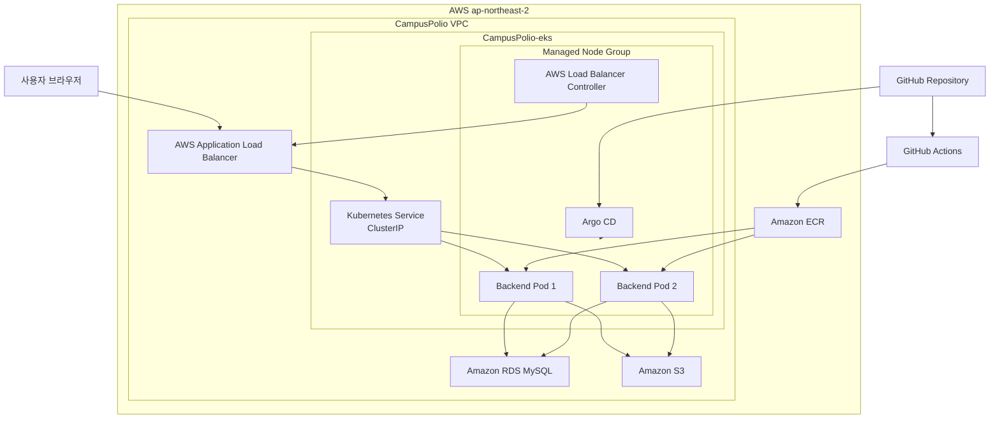
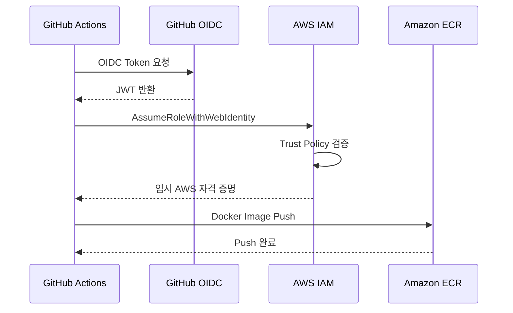
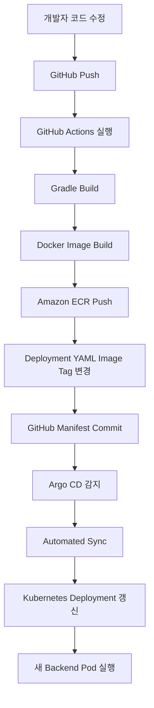

# CampusPolio EKS 및 Argo CD 기반 배포 인프라 구축 문서

- 프로젝트: CampusPolio
- AWS 리전: ap-northeast-2 (서울)
- Kubernetes: Amazon EKS
- 배포 자동화: GitHub Actions
- GitOps: Argo CD
- 컨테이너 저장소: Amazon ECR
- 애플리케이션: Spring Boot
- 문서 목적: EKS 기반 배포 환경의 구성 및 운영 방법 기록

---

# 1. 구축 목적

기존 CampusPolio는 AWS EC2와 Docker Compose를 이용하여 Spring Boot 애플리케이션을 배포했다.

이후 Kubernetes 기반 컨테이너 오케스트레이션과 GitOps 배포 방식을 학습하고, 기존 EC2 배포 환경과 별도로 EKS 기반 배포 환경을 구축했다.

이번 구축의 주요 목적은 다음과 같다.

1. Amazon EKS를 이용한 Kubernetes 클러스터 구축
2. Docker 이미지의 Amazon ECR 저장 및 관리
3. GitHub Actions를 이용한 CI/CD 파이프라인 구성
4. Argo CD를 이용한 GitOps 기반 배포 자동화
5. AWS Load Balancer Controller를 이용한 외부 트래픽 연결
6. EKS Pod Identity를 이용한 AWS 서비스 접근 권한 관리
7. Spring Boot 애플리케이션의 Kubernetes 배포 및 인증 기능 검증

# 2. 전체 인프라 아키텍처

## 2.1 시스템 구성도



※ 논리적인 구성도이며, 실제 네트워크 연결과 리소스 배치는 일부 단순화했다.

## 2.2 주요 AWS 리소스

| 리소스 | 구성 |
|---|---|
| VPC | CampusPolio-vpc |
| VPC CIDR | 10.0.0.0/16 |
| EKS Cluster | CampusPolio-eks |
| AWS Region | ap-northeast-2 |
| Node Group | CampusPolio-nodegroup |
| Node Instance | t3.medium |
| Node 수 | 2개 |
| 노드 AMI | Amazon Linux 2023 |
| 노드 디스크 | 20 GiB |
| RDS | 기존 CampusPolio MySQL RDS |
| ECR Repository | campuspolio-backend |
| NAT Gateway | nat-046d84cb7481de02b |

## 2.3 네트워크 구성

VPC 내부에 Public Subnet과 Private Subnet을 구성했다.

| 구분 | Subnet ID | 가용 영역 |
|---|---|---|
| Public Subnet | subnet-085e7036d9a43f890 | ap-northeast-2a |
| Private Subnet | subnet-0e672fce8bdbe47ef | ap-northeast-2a |
| Private Subnet | subnet-029774a8241c28de8 | ap-northeast-2b |

구성 목적:

- Public Subnet: 외부 트래픽을 수신하는 ALB 배치
- Private Subnet: EKS Worker Node 배치
- NAT Gateway: Private Subnet 내부 리소스의 외부 통신 지원
- RDS: 기존 데이터베이스를 유지하면서 EKS 애플리케이션과 연결

NAT Gateway:
- ID: nat-046d84cb7481de02b
- Public IP: 43.203.93.108
- Private IP: 10.0.3.192

# 3. Amazon EKS 구축

## 3.1 클러스터 생성

AWS EKS에서 다음과 같이 클러스터를 생성했다.

- 클러스터 이름: CampusPolio-eks
- 리전: ap-northeast-2
- VPC: CampusPolio-vpc
- Kubernetes 관리형 Control Plane 사용

EKS는 Control Plane을 AWS가 관리하고, 애플리케이션이 실행되는 Worker Node는 Managed Node Group으로 구성했다.

## 3.2 Managed Node Group

| 항목 | 설정 |
|---|---|
| Node Group 이름 | CampusPolio-nodegroup |
| 인스턴스 유형 | t3.medium |
| 노드 수 | 2 |
| AMI | Amazon Linux 2023 |
| 스토리지 | 20 GiB |
| 배치 | Private Subnet |

초기에는 t2.micro를 사용했으나 Worker Node가 클러스터에 정상적으로 조인하지 못하는 문제가 발생했다.

이후 노드 그룹 및 IAM 권한 설정을 점검하고 노드 그룹을 다시 구성하여 Kubernetes Node 상태가 `Ready`로 표시되는 것을 확인했다.

## 3.3 EKS Add-ons

다음 Kubernetes Add-on을 구성했다.

| Add-on | 역할 |
|---|---|
| Amazon VPC CNI | Pod 네트워크 및 IP 할당 |
| CoreDNS | Kubernetes 내부 DNS |
| kube-proxy | 서비스 네트워크 및 트래픽 전달 |
| EKS Pod Identity Agent | Pod의 AWS IAM 권한 연결 |
| Node Monitoring Agent | 노드 상태 모니터링 |
| Metrics Server | 리소스 사용량 수집 |
| External DNS | Kubernetes 리소스와 DNS 연동을 위한 구성 요소 |

# 4. AWS IAM 및 인증 구성

## 4.1 GitHub Actions OIDC

GitHub Actions에서 AWS 자격 증명을 사용하기 위해 OIDC 기반 인증을 구성했다.

기존에는 AWS Access Key와 Secret Key를 GitHub Secrets에 저장하는 방식 대신, GitHub Actions가 OIDC 토큰을 발급하고 AWS IAM Role을 Assume하는 방식을 사용했다.

구성한 IAM Role:

`GitHubActions-ECR-Push-Role`

역할:
- GitHub Actions OIDC 인증
- ECR 로그인
- Docker 이미지 Push
- ECR 이미지 관련 작업 수행

OIDC 인증 흐름:



ECR Push 권한은 다음 두 Repository를 대상으로 설정했다.

- campuspolio-hello
- campuspolio-backend

## 4.2 EKS Pod Identity

Spring Boot 애플리케이션에서 AWS S3 등의 서비스를 사용할 수 있도록 EKS Pod Identity를 구성했다.

구성 정보:

| 항목 | 설정 |
|---|---|
| IAM Role | CampusPolio-Backend-PodRole |
| Kubernetes Namespace | default |
| ServiceAccount | campuspolio-backend-sa |
| 인증 방식 | EKS Pod Identity |

Backend Pod는 ServiceAccount를 통해 IAM Role에 연결되며, 별도의 AWS Access Key를 애플리케이션 설정에 저장하지 않고 AWS SDK의 기본 자격 증명 공급자(DefaultCredentialsProvider)를 이용하도록 구성했다.

실제로 STS GetCallerIdentity 호출을 통해 Pod에 연결된 IAM 권한이 정상적으로 적용되는 것을 확인했다.

# 5. Amazon ECR 구성

Spring Boot 애플리케이션의 Docker 이미지를 저장하기 위해 Amazon ECR을 사용했다.

Repository:

`campuspolio-backend`

이미지 주소 형식:

```text
034317881539.dkr.ecr.ap-northeast-2.amazonaws.com/campuspolio-backend:<TAG>
```

GitHub Actions에서 빌드된 이미지는 Git Commit SHA를 Tag로 사용하도록 구성했다.

이를 통해 어떤 Git Commit으로 생성된 이미지인지 추적할 수 있도록 했다.

# 6. Kubernetes 애플리케이션 배포

## 6.1 Namespace

Backend 애플리케이션은 `default` Namespace에 배포했다.

Argo CD는 별도 `argocd` Namespace에 설치했다.

## 6.2 Deployment

Deployment 이름:

`campuspolio-backend`

주요 설정:

| 항목 | 설정 |
|---|---|
| Deployment | campuspolio-backend |
| Namespace | default |
| Replicas | 2 |
| Container Port | 8080 |
| ServiceAccount | campuspolio-backend-sa |
| Image Pull Policy | IfNotPresent |
| Spring Profile | prod |
| Secret | campuspolio-backend-secret |

Deployment 주요 설정 예시:

```yaml
apiVersion: apps/v1
kind: Deployment
metadata:
  name: campuspolio-backend
  namespace: default
spec:
  replicas: 2
  selector:
    matchLabels:
      app: campuspolio-backend
  template:
    metadata:
      labels:
        app: campuspolio-backend
    spec:
      serviceAccountName: campuspolio-backend-sa
      containers:
        - name: campuspolio-backend
          image: 034317881539.dkr.ecr.ap-northeast-2.amazonaws.com/campuspolio-backend:<TAG>
          imagePullPolicy: IfNotPresent
          ports:
            - containerPort: 8080
          env:
            - name: SPRING_PROFILES_ACTIVE
              value: "prod"
          envFrom:
            - secretRef:
                name: campuspolio-backend-secret
```

실제 운영 매니페스트에서는 `<TAG>` 대신 GitHub Actions가 생성한 Commit SHA Tag를 사용했다.

## 6.3 Service

Backend Pod에 접근하기 위한 Kubernetes Service를 생성했다.

Service 유형은 `ClusterIP`로 구성했다.

역할:
- Backend Pod를 내부 네트워크에서 노출
- Pod가 교체되어 IP가 변경되더라도 고정된 서비스 주소 제공
- Ingress를 통해 외부 트래픽 전달

## 6.4 Ingress 및 ALB

AWS Load Balancer Controller를 설치하여 Kubernetes Ingress 리소스를 AWS Application Load Balancer와 연결했다.

구성 요소:

- AWS Load Balancer Controller
- Kubernetes Ingress
- AWS Application Load Balancer
- ACM 인증서

API 도메인:

`api.campuspolio.cloud`

Ingress에서 ALB를 생성하고 ACM 인증서를 연결하여 HTTPS 통신을 구성했다.

실제 API ALB DNS:

`k8s-default-campuspo-bbe2b29bc5-765466277.ap-northeast-2.elb.amazonaws.com`

ACM 인증서가 발급된 이후 DNS 및 TLS 설정을 점검하여 HTTPS 연결을 정상화했다.

# 7. Argo CD GitOps 구성

## 7.1 Argo CD 도입 목적

기존 CI/CD 방식에서는 GitHub Actions가 애플리케이션 빌드와 배포를 모두 수행했다.

EKS에서는 GitOps 방식을 학습하기 위해 Argo CD를 도입했다.

GitOps란 Git Repository에 저장된 Kubernetes 매니페스트를 배포 상태의 기준으로 삼고, 클러스터의 실제 상태를 Git에 선언된 상태와 일치시키는 방식이다.

Argo CD는 Git Repository를 감시하고, 선언된 설정과 실제 Kubernetes 리소스의 차이를 비교한다.

## 7.2 설치 위치

Argo CD는 다음 Namespace에 설치했다.

`argocd`

설치 후 다음 구성 요소가 실행되는 것을 확인했다.

- Argo CD Server
- Application Controller
- Repo Server
- Redis
- ApplicationSet Controller
- Notifications Controller

## 7.3 Git Repository 연결

Argo CD Application은 CampusPolio GitHub Repository를 바라보도록 구성했다.

Repository:

`https://github.com/pokowoo/CampusPolio`

Branch:

`feature/eks-cicd`

Manifest 경로:

`eks-lab/backend`

## 7.4 Argo CD Application 설정

Application 이름:

`campuspolio-backend`

주요 설정:

| 항목 | 값 |
|---|---|
| Application | campuspolio-backend |
| Source Repository | CampusPolio GitHub |
| Target Revision | feature/eks-cicd |
| Path | eks-lab/backend |
| Destination Namespace | default |
| Sync Policy | Automated |
| Prune | Enabled |
| Self Heal | Enabled |

주요 동작:

- Automated Sync: Git 변경 사항을 자동으로 클러스터에 반영
- Prune: Git에서 삭제된 리소스를 클러스터에서도 제거
- Self Heal: Git 선언 상태와 실제 클러스터 상태가 달라지면 자동으로 복구

## 7.5 GitOps 배포 흐름



# 8. GitHub Actions CI/CD 구성

## 8.1 Workflow 파일

EKS Backend 배포용 Workflow:

`.github/workflows/deploy-eks-backend.yml`

기존 EC2 배포용 Workflow:

`.github/workflows/deploy.yml`

기존 Hello World EKS 실습용 Workflow:

`.github/workflows/build-and-push-ecr.yml`

각 Workflow는 서로 다른 배포 목적을 갖도록 구성했다.

## 8.2 Backend 배포 과정

1. GitHub Repository에 코드 Push
2. GitHub Actions Workflow 실행
3. Java 21 환경 구성
4. Gradle Build
5. Docker Image 생성
6. AWS OIDC 인증
7. Amazon ECR 로그인
8. Docker Image Push
9. Kubernetes Deployment YAML의 Image Tag 변경
10. 변경된 YAML을 GitHub에 Commit
11. Argo CD가 변경 사항 감지
12. Kubernetes에 새 버전 배포

빌드 명령:

```bash
./gradlew clean build -x test
```

테스트 실행을 제외하고 빌드하도록 구성했다.

## 8.3 이미지 Tag 관리

이미지 Tag는 GitHub Commit SHA를 사용했다.

예시:

```text
campuspolio-backend:19eaf5e
```

`latest` 대신 Commit SHA를 사용하는 이유는 다음과 같다.

- 배포 버전 추적
- 특정 Commit에 대응하는 이미지 식별
- 이전 버전으로 Rollback할 때 편리
- 이미지 변경 여부를 명확하게 관리

# 9. 데이터베이스 및 외부 서비스 연결

## 9.1 RDS

기존 CampusPolio에서 사용하던 Amazon RDS MySQL을 EKS Backend에서도 사용했다.

- 기존 RDS 유지
- Public Access Disabled
- EKS Node Security Group을 통한 3306 접근 허용
- Spring Boot에서 prod 프로파일 사용

EKS에서 RDS로 연결되는 것을 확인했다.

## 9.2 S3

Backend Pod에서 S3를 사용할 수 있도록 EKS Pod Identity를 구성했다.

애플리케이션은 AWS SDK의 DefaultCredentialsProvider를 사용하도록 설정했다.

## 9.3 JWT 인증

EKS 환경에서 JWT 기반 로그인, 로그아웃, Refresh Token 갱신을 테스트했다.

주요 구성:

| 항목 | 설정 |
|---|---|
| Access Token 만료 | 15분 |
| Refresh Token 만료 | 14일 |
| 저장 방식 | HttpOnly Cookie |
| Access Token 검증 | Spring Security JWT Filter |
| Refresh Token 저장 | MySQL |
| Refresh Token DB 저장값 | SHA-256 Hash |
| Refresh Token 갱신 | Rotation |

EKS에서 로그인, 로그아웃, Refresh Token 갱신이 정상적으로 동작하는 것을 확인했다.

# 10. 구축 과정에서 발생한 주요 문제 및 해결

## 10.1 EKS Worker Node 조인 실패

문제:
- Node Group 생성 과정에서 인스턴스가 EKS Cluster에 정상적으로 조인하지 못함
- `kubectl get nodes` 실행 시 노드가 표시되지 않음

해결:
- Node Group 설정과 IAM 권한 점검
- 노드 그룹 재구성
- 노드가 `Ready` 상태로 등록되는 것 확인

## 10.2 GitHub Actions ECR Push 권한 오류

문제:
- 기존 IAM Policy가 Hello World용 ECR Repository만 허용
- Backend Image Push 과정에서 권한 오류 발생

해결:
- `campuspolio-backend` Repository ARN을 IAM Policy에 추가
- 기존 `campuspolio-hello` 권한 유지
- ECR Push 권한 정상화

## 10.3 Argo CD OutOfSync

문제:
- Argo CD Application이 Git Repository의 매니페스트와 실제 클러스터 상태가 일치하지 않는 상태로 표시됨

해결:
- Repository 주소, Branch, Manifest 경로 확인
- Kubernetes 리소스 생성 및 동기화 상태 점검
- Application Sync 상태 확인

## 10.4 HTTPS 인증서 연결 문제

문제:
- ALB와 ACM 인증서 연결 및 DNS 전파 과정에서 HTTPS 접속 문제 발생

해결:
- ACM 인증서 발급 상태 확인
- Ingress 및 ALB 설정 점검
- DNS 연결 상태 확인
- HTTPS 접속 정상화

## 10.5 EKS Pod의 AWS 서비스 접근

문제:
- Backend Pod에서 AWS 서비스에 접근하기 위한 권한 설정 필요

해결:
- EKS Pod Identity Agent 설치
- IAM Role 생성
- ServiceAccount 연결
- STS GetCallerIdentity 호출로 권한 적용 확인

# 11. 최종 검증 결과

| 검증 항목 | 결과 |
|---|---|
| EKS Cluster 생성 | 완료 |
| Worker Node Ready | 확인 |
| ECR 이미지 Push | 완료 |
| GitHub Actions OIDC 인증 | 구성 및 사용 |
| Argo CD 설치 | 완료 |
| Argo CD Application 연결 | 완료 |
| Automated Sync | 구성 |
| Backend Pod 2개 실행 | 확인 |
| RDS 연결 | 확인 |
| S3 IAM 접근 | 확인 |
| ALB Ingress HTTPS | 확인 |
| JWT 로그인 | 정상 동작 확인 |
| JWT 로그아웃 | 정상 동작 확인 |
| Refresh Token 갱신 | 정상 동작 확인 |

# 12. 향후 운영 및 리소스 정리 계획

EKS 기반 배포 실습을 완료한 후 기존 EC2 기반 운영 환경으로 복귀하는 것을 계획하고 있다.

EC2 환경으로 복귀할 때는 다음 순서로 진행한다.

1. 기존 EC2 Docker Container 상태 확인
2. EC2 Nginx 및 HTTPS 인증서 확인
3. EC2의 JWT Secret 및 RDS 설정 확인
4. API 도메인의 DNS를 EC2 Elastic IP로 변경
5. 로그인, 로그아웃, Refresh Token 기능 검증
6. EKS ALB 및 불필요한 네트워크 리소스 정리
7. EKS Cluster 및 Node Group 삭제 여부 결정

EKS를 삭제하더라도 다음 자료는 GitHub에 보관한다.

- `eks-lab/backend/` Kubernetes Manifest
- `.github/workflows/deploy-eks-backend.yml`
- EKS 및 Argo CD 설정 기록
- IAM Role 및 Policy 구성 정보
- 네트워크 구성 정보
- 구축 과정에서 발생한 문제와 해결 방법

이를 통해 추후 EKS 환경을 재구축하거나 Kubernetes 기반 배포를 다시 실습할 수 있도록 한다.

---

# 부록 A. 주요 명령어

## Kubernetes 상태 확인

```bash
kubectl get nodes
kubectl get pods -A
kubectl get svc -A
kubectl get ingress -A
```

## Backend 상태 확인

```bash
kubectl get deployment campuspolio-backend
kubectl get pods -l app=campuspolio-backend
kubectl describe deployment campuspolio-backend
```

## Argo CD 상태 확인

```bash
kubectl get pods -n argocd
kubectl get applications -n argocd
```

## Backend 로그 확인

```bash
kubectl logs -l app=campuspolio-backend
```

## Deployment 상세 확인

```bash
kubectl describe deployment campuspolio-backend
```

---

# 부록 B. 참고 Repository

- CampusPolio GitHub: https://github.com/pokowoo/CampusPolio
- 실습 Branch: `feature/eks-cicd`
- Backend Kubernetes Manifest: `eks-lab/backend`
- EKS Hello World 실습: `eks-lab/`
- Backend CI/CD Workflow: `.github/workflows/deploy-eks-backend.yml`

# 문서 작성 시 유의사항

본 문서는 구축 당시 확인된 설정과 테스트 결과를 기준으로 작성했다. AWS 리소스의 세부 속성, 모든 IAM Policy 전문, Ingress YAML의 전체 설정, Argo CD 초기 설치 명령 및 Helm Chart 버전 등 대화에서 확인되지 않은 정보는 추가 확인이 필요하다.